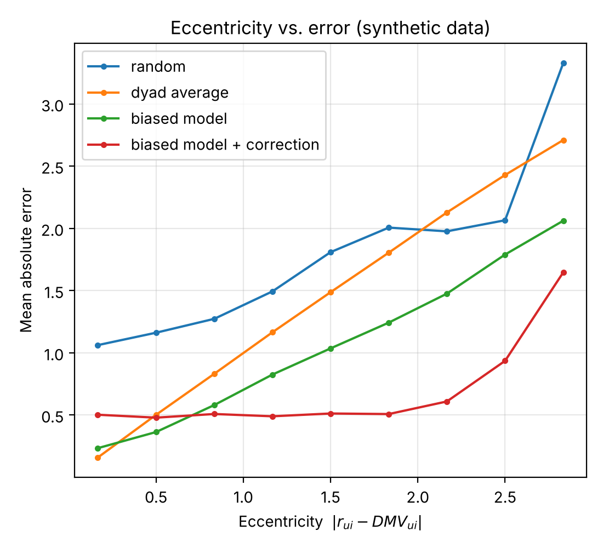

<div align="center">

# EAUC: Eccentricity-Area Under the Curve

**Beyond RMSE and MAE: unmask hidden bias and unfairness in recommenders, drug response, trade ....**

[](https://doi.org/10.48550/arXiv.2401.10690)
[](LICENSE)
[](https://www.python.org/)

Jorge Paz Ruza et al. · Universidade da Coruña, CITIC



<sub>Illustrative curves on synthetic data, produced by <code>examples/synthetic_example.py</code>. They are not results from the paper.</sub>

</div>

## Overview

Dyadic regression models predict a real value for a pair of entities, such as the rating a user gives an item. The paper shows that state-of-the-art models are biased towards the mean past value of the entities involved (**eccentricity bias**): they are precise when an observation is close to what the entities usually get, and much worse, even worse than random, when it is not. Global metrics such as RMSE and MAE do not see this. **EAUC** does: it integrates the prediction error over the eccentricity of the observations, so it rewards models that stay accurate on the unusual cases where fairness matters most.

This repository contains:

- **`eauc`, an installable library** with the metric, the *eccentricity vs. error* curve, the dataset-level KS uniformity statistic and the post-training bias corrections of the paper. It works on any `(user, item, value, prediction)` table, whatever the domain.
- **The evaluation framework of the paper**: the model wrappers and analysis scripts used to produce the experiments.

## Installation

```bash
git clone https://github.com/Kominaru/EAUC.git
cd EAUC
pip install -e .          # numpy, pandas, scikit-learn, scipy
pip install -e ".[plot]"  # optionally, matplotlib for the plotting options
```

## Quickstart

Score any model from two CSV files (`user_id, item_id, rating` for the train set, plus `pred` for the test set):

```python
import pandas as pd
from eauc import eauc, eccentricity_error_curve, dataset_ks

train = pd.read_csv("train.csv")   # columns: user_id, item_id, rating
test = pd.read_csv("test.csv")     # columns: user_id, item_id, rating, pred

print(eauc(train, test))                          # 0.0 (best) .. 1.0 (worst)
print(eccentricity_error_curve(train, test))      # MAE per eccentricity bin
print(dataset_ks(pd.concat([train, test])))       # how prone the dataset is to induce the bias
```

## Repository layout

| Path | Contents |
|---|---|
| `eauc/` | The Python package: metric (`metrics.py`), post-hoc corrections (`correction.py`), command line (`cli.py`) |
| `tests/` | Tests of the metric, the corrections and the command line (`pytest`) |
| `examples/synthetic_example.py` | End-to-end example on synthetic data |
| `models/` | Model wrappers used in the paper: MF, GC-MC, GLocal-K, Bayesian SVD++, MRMA and trivial baselines |
| `src/` | Analysis and figure scripts of the paper experiments (`avg_bias_auc_analysis.py`, `regression_corrector.py`, `dataset_complexity_measure.py`, `figure_scripts/`) |
| `download_data.py` | Downloads the public datasets (`python download_data.py ml-1m`) |
| `envs_requirements/` | Pinned environments of the model wrappers used in the paper |

## Citation

If you use EAUC or this code, please cite the paper (GitHub's "Cite this repository" button uses [`CITATION.cff`](CITATION.cff)):

```bibtex
@article{paz2024beyond,
  title   = {Beyond {RMSE} and {MAE}: Introducing {EAUC} to unmask hidden bias and unfairness in dyadic regression models},
  author  = {Paz-Ruza, Jorge and Alonso-Betanzos, Amparo and Guijarro-Berdi{\~n}as, Bertha and Cancela, Brais and Eiras-Franco, Carlos},
  journal = {arXiv preprint arXiv:2401.10690},
  year    = {2024},
  doi     = {10.48550/arXiv.2401.10690},
  url     = {https://arxiv.org/abs/2401.10690}
}
```

## Authors

**Jorge Paz Ruza** [](https://orcid.org/0000-0002-7869-1070) [](https://www.linkedin.com/in/jorge-paz-ruza-646141186/)<br>
**Amparo Alonso Betanzos** [](https://orcid.org/0000-0003-0950-0012) [](https://www.linkedin.com/in/amparo-alonso-80516211/)<br>
**Bertha Guijarro Berdiñas**<br>
**Brais Cancela** [](https://orcid.org/0000-0002-2295-4142)<br>
**Carlos Eiras Franco** [](https://orcid.org/0000-0001-6322-7593) [](https://www.linkedin.com/in/carloseiras/)

LIDIA Group, CITIC, Universidade da Coruña (A Coruña, Spain).

## License

Code released under the [MIT License](LICENSE). Wrappers in `models/` built on third-party implementations keep their original licenses.
